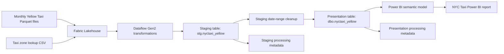
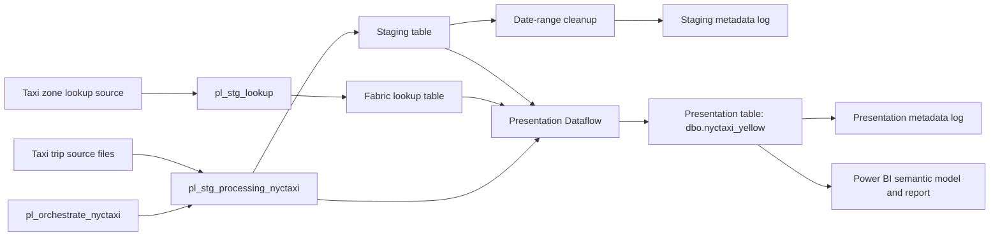

# NYC Taxi Data Engineering Project with Microsoft Fabric

An end-to-end data engineering and analytics project built with Microsoft Fabric and NYC Yellow Taxi trip data. The project ingests and transforms trip records, enriches them with taxi zone information, tracks processing metadata, and presents the results in a Power BI report.

> **Project status:** The Fabric pipeline runs successfully and refreshes the data when executed. A Power BI report has also been created. This repository documents the project and can include screenshots, SQL scripts, and an exported Power BI file if available.

---

## Project Overview

This project demonstrates an end-to-end data workflow that:

1. Loads monthly taxi trip data and a taxi zone lookup file into Microsoft Fabric.
2. Uses Dataflow Gen2 to clean, type, and enrich the data.
3. Processes data through staging and presentation tables.
4. Uses SQL procedures to clean records and write processing metadata.
5. Presents trip, passenger, payment, and revenue information in Power BI.

---

## Project Screenshots

### Microsoft Fabric Workspace and Item Lineage

This screenshot shows the Fabric items used in the project and how the warehouse, lakehouse, dataflows, pipelines, semantic model, and report are connected.


### Dataflow Gen2 Transformation

This screenshot shows the Dataflow Gen2 transformation steps, including the trip data and taxi zone lookup merge, column type changes, and transformed output.


### Power BI Dashboard

This screenshot shows the report page with trip and passenger KPIs, revenue, payment method comparisons, a date range filter, and vendor and payment filters.


---

## Dataset

- **Data:** NYC Yellow Taxi trip records and taxi zone lookup reference data.
- **Trip data format:** Monthly Parquet files.
- **Lookup data:** CSV file containing taxi zone and borough information.
- **Fields used in the presentation table:** Vendor, pickup and drop-off dates, pickup and drop-off boroughs and zones, payment method, passenger count, trip distance, and total amount.
- **Raw data:** Not included in this repository because the source files are large.

---

## Technology Stack

- Microsoft Fabric
- Fabric Lakehouse and Warehouse
- Dataflow Gen2 / Power Query
- Fabric Data Pipelines
- SQL stored procedures
- Metadata logging
- Power BI semantic model and report
- Parquet and CSV

---

## Architecture



---


## Fabric Pipelines: Purpose and Execution Flow

The project uses separate pipelines for different processing tasks. The data moves from source ingestion through staging and presentation, while an orchestration pipeline provides a single way to run the main processing pipelines in order.

### 1. `pl_stg_lookup` — Load the Taxi Zone Lookup

This pipeline copies the taxi zone lookup table into Fabric.


- **Activity:** `Copy lookup table`
- **Purpose:** Loads reference data containing taxi zone and borough details.
- **How it is used:** The lookup data is later joined with taxi trip records to provide readable pickup and drop-off borough and zone names.

**Flow:** Taxi zone lookup source → Fabric lookup table

### 2. `pl_stg_processing_nyctaxi` — Load and Prepare Staging Data


This pipeline processes the taxi trip data in the staging layer.

Its activities run in sequence:

1. **`latest processed data` script** — reads processing metadata to identify the latest pickup date already recorded.
2. **Set variable `v_date`** — stores the date value used by later activities.
3. **`connect to staging` copy activity** — copies the source taxi records into the staging table.
4. **Set variable `v_end_date`** — stores the end date used to define the processing window.
5. **`sp_removing_outlier_dates` stored procedure** — removes staging records outside the intended pickup date range.
6. **`sp_loading_staging_metadata` stored procedure** — records staging processing details, including the row count and latest pickup date.

**Flow:** Source taxi trip data → staging table → date-range cleanup → staging metadata log

### 3. `pl_pres_processing_nyctaxi` — Transform Data for Presentation


This pipeline prepares the cleaned staging data for reporting.

Its activities run in sequence:

1. **`process to presentation` Dataflow** — transforms the staged records and writes the presentation-ready output. The transformation includes the data preparation and lookup enrichment configured in the Dataflow.
2. **`sp loading presentation metadata` stored procedure** — records processing details for the presentation data.

**Flow:** Clean staging data → presentation Dataflow → presentation table → presentation metadata log

The presentation table, `dbo.nyctaxi_yellow`, provides the fields used by the Power BI semantic model and report.

### 4. `pl_orchestrate_nyctaxi` — Coordinate the Main Processing Pipelines


This pipeline provides a single entry point for running the staging and presentation processing pipelines in order.

Its activities are:

1. **Invoke staging pipeline** — runs `pl_stg_processing_nyctaxi`.
2. **Invoke presentation pipeline** — runs `pl_pres_processing_nyctaxi` after the staging pipeline succeeds.

**Flow:** Orchestrator → staging pipeline → presentation pipeline

The lookup pipeline, `pl_stg_lookup`, is a separate pipeline that loads the reference data required by the transformations. It can be run before the processing flow when the lookup data needs to be loaded or refreshed.

### End-to-End Data Flow



## Pipeline Summary

| Pipeline | Main responsibility | Output |
|---|---|---|
| `pl_stg_lookup` | Copies taxi zone reference data into Fabric. | Lookup table |
| `pl_stg_processing_nyctaxi` | Loads taxi trip data into staging, applies date-range cleanup, and logs staging metadata. | Cleaned staging table and staging log entry |
| `pl_pres_processing_nyctaxi` | Transforms staging data for reporting and logs presentation metadata. | Presentation table and presentation log entry |
| `pl_orchestrate_nyctaxi` | Invokes the staging and presentation pipelines in sequence. | Coordinated processing run |

## Workflow and Implementation

### 1. Load the Source Data

Monthly NYC Yellow Taxi Parquet files and the taxi zone lookup CSV are loaded into Microsoft Fabric. The trip data provides journey details, while the lookup file provides descriptive zone and borough names.

### 2. Transform the Data with Dataflow Gen2

Dataflow Gen2 applies data type conversions and combines trip records with the taxi zone lookup data. The lookup enriches pickup and drop-off location identifiers with borough and zone descriptions. The transformed data is written to the staging table.

### 3. Clean the Staging Data

The staging stored procedure removes records whose pickup date falls outside the supplied date range:

```sql
CREATE PROCEDURE stg.data_cleaning_stg
    @end_date DATETIME2,
    @start_date DATETIME2
AS
DELETE FROM stg.nyctaxi_yellow
WHERE tpep_pickup_datetime < @start_date
   OR tpep_pickup_datetime > @end_date;
```

The date parameters let the pipeline limit staged data to the required processing window.

### 4. Create the Presentation Table

The presentation table contains the cleaned and enriched fields used by the reporting layer:

```sql
CREATE TABLE dbo.nyctaxi_yellow (
    vendor VARCHAR(50),
    tpep_pickup_datetime DATE,
    tpep_dropoff_datetime DATE,
    pu_borough VARCHAR(100),
    pu_zone VARCHAR(100),
    do_borough VARCHAR(100),
    do_zone VARCHAR(100),
    payment_method VARCHAR(50),
    passenger_count INT,
    trip_distance FLOAT,
    total_amount FLOAT
);
```

This table provides an analysis-ready structure for the Power BI semantic model and report.

### 5. Create the Metadata Log

The metadata schema and table store information about processed tables, row counts, the latest pickup date, and processing timestamps:

```sql
CREATE SCHEMA metadata;

CREATE TABLE metadata.processing_log (
    pipeline_run_id VARCHAR(255),
    table_processed VARCHAR(255),
    rows_processed INT,
    latest_processed_pickup DATETIME2(6),
    processed_datetime DATETIME2(6)
);
```

This log supports basic monitoring and helps identify when data was processed and how many rows were present.

### 6. Log Staging Processing Details

The staging metadata procedure records a row count and the most recent pickup timestamp from the staging table:

```sql
CREATE PROCEDURE metadata.insert_staging_metadata
    @pipeline_run_id VARCHAR(255),
    @table_name VARCHAR(255),
    @processed_date DATETIME2
AS
INSERT INTO metadata.processing_log (
    pipeline_run_id,
    table_processed,
    rows_processed,
    latest_processed_pickup,
    processed_datetime
)
SELECT
    @pipeline_run_id,
    @table_name,
    COUNT(*),
    MAX(tpep_pickup_datetime),
    @processed_date
FROM stg.nyctaxi_yellow;
```

### 7. Log Presentation Processing Details

The presentation metadata procedure records corresponding processing details for the final reporting table:

```sql
CREATE PROCEDURE metadata.insert_presentation_metadata
    @pipeline_run_id VARCHAR(255),
    @table_name VARCHAR(255),
    @processed_date DATETIME2
AS
INSERT INTO metadata.processing_log (
    pipeline_run_id,
    table_processed,
    rows_processed,
    latest_processed_pickup,
    processed_datetime
)
SELECT
    @pipeline_run_id,
    @table_name,
    COUNT(*),
    MAX(tpep_pickup_datetime),
    @processed_date
FROM dbo.nyctaxi_yellow;
```

The pipeline supplies the run ID, table name, and processing timestamp so each procedure can record the relevant processing details.

### 8. Build the Power BI Report

The Power BI report uses the processed data to present summary metrics and comparisons. The report screenshot includes:

- Date range selection
- Payment method filter
- Vendor filter
- Total trips KPI
- Passenger count KPI
- Total revenue KPI
- Payment method comparison chart
- Borough and zone summary table


## SQL Query Summary

| SQL object | Purpose |
|---|---|
| `stg.data_cleaning_stg` | Removes staged rows outside the selected pickup date range. |
| `metadata.processing_log` | Stores processing counts, latest pickup timestamps, table names, and run timestamps. |
| `metadata.insert_staging_metadata` | Records processing details for the staging table. |
| `dbo.nyctaxi_yellow` | Defines the presentation table used by the reporting layer. |
| `metadata.insert_presentation_metadata` | Records processing details for the presentation table. |

The separate aggregate `SELECT` query shared during development can be used to inspect the staging row count and latest pickup date. Its literal values are placeholders; the stored procedure is used to write run-specific metadata.

---
## Reproducing the Project

1. Set up a Microsoft Fabric workspace with the required Lakehouse, Warehouse, and pipeline capabilities.
2. Obtain the trip data and taxi zone lookup file from their original source.
3. Configure the Fabric data sources and destinations.
4. Build the Dataflow Gen2 transformations and pipeline activities.
5. Create the SQL tables, schema, and stored procedures.
6. Run the pipeline and confirm that the staging, presentation, and metadata tables update.
7. Refresh the semantic model and Power BI report.

Reproducing the project requires access to a Fabric workspace and the appropriate permissions and capacity. Screenshots and this README describe the implementation; they are not deployable Fabric workspace items.

---

## Notes

- The source Parquet data is not included because of its size.
- Do not commit passwords, access tokens, connection strings, or other secrets.
- Fabric trial workspaces and capacity availability may change over time.
- Check the source dataset's terms before redistributing its data.
- No repository license has been specified. Add a license file if you want to define reuse permissions.

